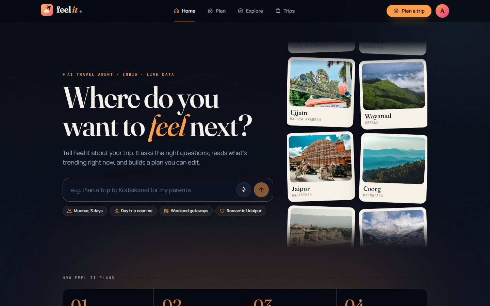
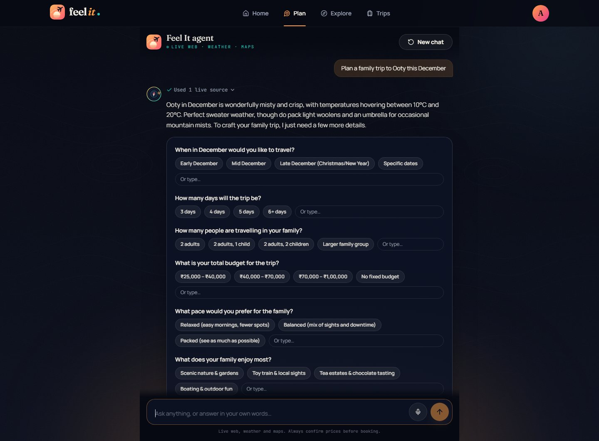
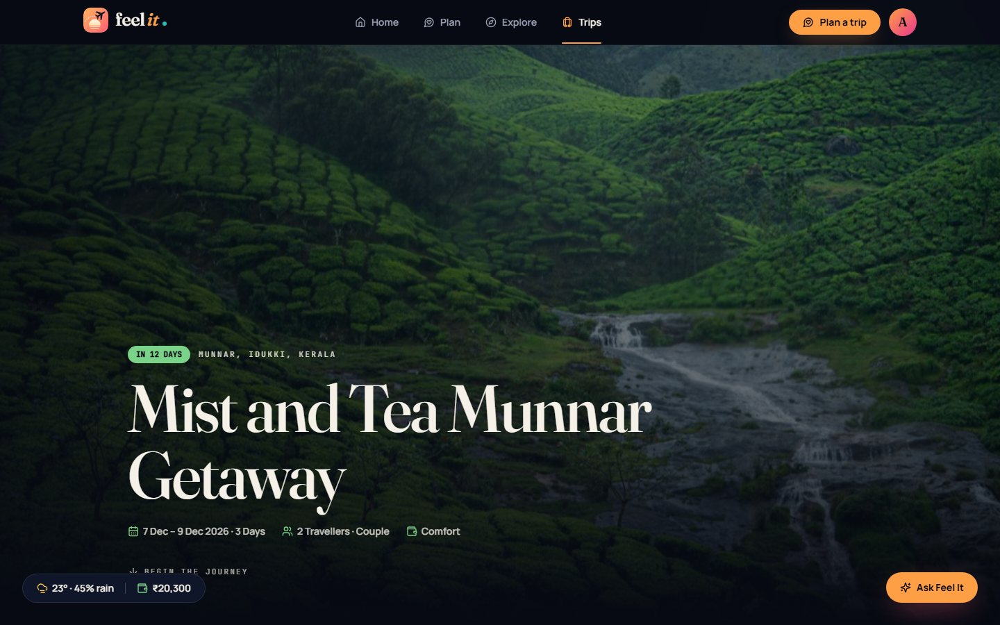
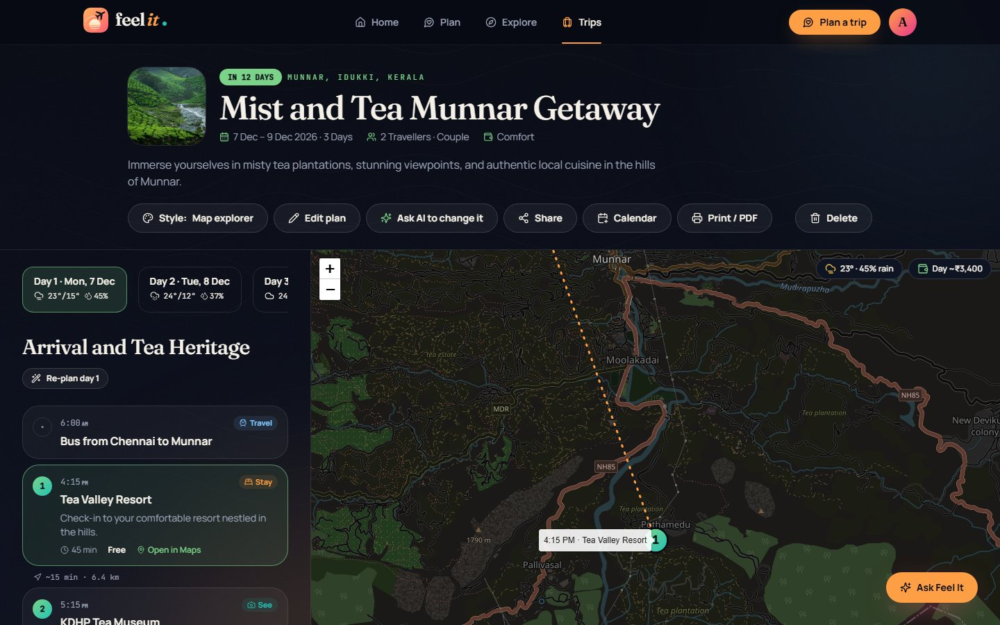
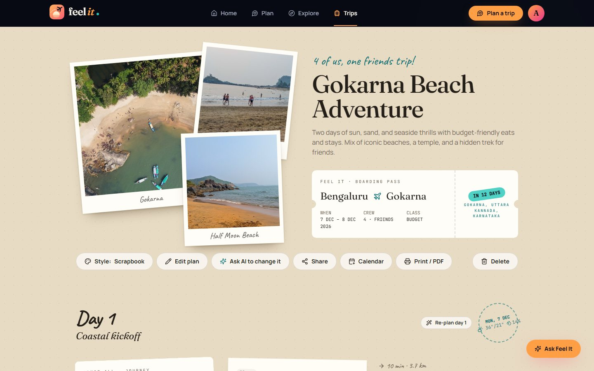
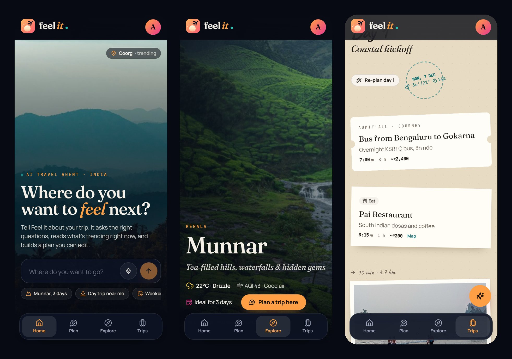
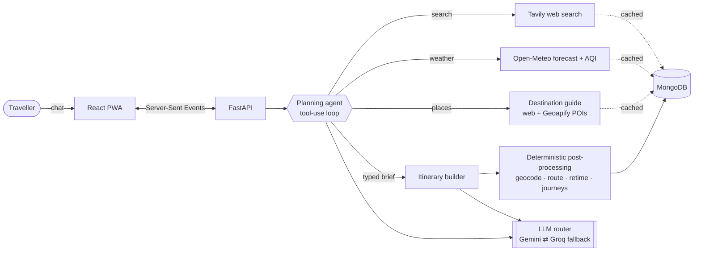

<div align="center">

# ✈️ Feel It — Agentic AI Travel Planner for India

**Tell it where you want to go. It asks the right questions, checks the live web, weather and maps, and builds a real day-by-day trip you can edit by hand or by talking to it.**

[](#tech-stack)
[](#tech-stack)
[](#tech-stack)
[](#tech-stack)
[](#how-the-ai-works)
[](#quality-and-testing)

**[Live demo](https://your-app.vercel.app)** · [How the AI works](#how-the-ai-works) · [Features](#features) · [Run locally](#run-locally) · [Deploy](#deployment)

</div>

<p align="center">
  
</p>

| The agent asks before it plans | Each trip told like a travel magazine |
|---|---|
|  |  |
| **Map explorer**: the live map follows the day's route | **Scrapbook**: the layout chosen for trips with friends |
|  |  |

<p align="center">
  
  <br><sub>Mobile-first and installable as an app: home, a live destination guide and a trip on the phone</sub>
</p>

---

## Why Feel It is different

Most "AI trip planners" send one prompt to a model and print whatever comes back, including invented places and impossible timings. Feel It is built as an **agent with tools, guardrails and deterministic post-processing**:

- 🧭 **Plans like a human agent.** A tool-using agent asks its questions in one round as tappable cards (budget, dates, food, pace, who's travelling), checks the forecast, then hands over an **editable trip brief** before building anything.
- 🌐 **Grounded in live data, not model memory.** Places come from live web search and real map data. Every stop is **geocode-verified** before it reaches the map, and weather, festivals and trending spots are fetched live.
- ⏱️ **Realistic plans.** Code, not the LLM, orders stops geographically, re-times the day from real distances, never moves a train, and guarantees the journey there and back.
- 🛡️ **Production-grade reliability.** Four LLMs across two providers with automatic fallback, schema-validated JSON, retries, rate limits, a MongoDB response cache and streaming progress over Server-Sent Events.
- 🎨 **Adaptive, story-driven UI.** Each trip picks one of **six layouts** from its own data (a cinematic magazine for nature trips, a scrapbook for friends, minimal luxury for luxury stays), coloured to match the destination.
- 📬 **Closes the loop.** One reminder email the evening before each trip, with the day-1 plan and the live forecast, delivered exactly once.

---

## How the AI works



### 1. The planning agent: a tool-using loop

`Feelit_backend/app/services/agent.py`

- **Tool protocol.** The model answers every turn with one JSON object: either a tool call (`search`, `weather`, `places`) or a final answer. The loop runs the tool, feeds back a truncated result, and repeats, with **at most three tool calls per turn** before it must answer.
- **Live progress.** Each tool step streams to the UI as it runs ("Searching the web…", "Checking live weather in Munnar…"), and the sources used are shown as links.
- **Human-style questioning.** For a trip request it asks only for what's missing, in one round of tappable question cards. Answers the traveller's profile already covers (home city, style, food) are skipped.
- **Typed output.** It finishes with a **trip brief**: destination, dates, days, travellers, budget, food, pace and interests. The brief is validated against a Pydantic schema and shown as an editable boarding pass. The agent never writes the itinerary itself; a dedicated builder does.
- **Memory.** The raw structured answers are sent back as history, so the agent remembers what it already asked.
- **Guardrails.** India only, never invent places or prices, resolve relative dates ("next weekend") against today, and flag every number as an estimate.

### 2. The itinerary builder: retrieval, generation, then verification

`Feelit_backend/app/services/planner.py`, `route.py`, `geo.py`

| Stage | What happens |
|---|---|
| **Retrieve** (in parallel) | A destination guide built from live web sources, map points of interest within 30 km, the 16-day forecast for the travel dates, and a web search for festivals and events during the trip. |
| **Generate** | A constrained prompt with the brief, weather, events, guide and map list. The rules: use only listed places, fill each day to the chosen pace (4–9 places plus meals), respect opening hours and meal times, prefer indoor stops on rainy days, stay within budget. |
| **Validate** | Output is parsed into Pydantic models with lenient coercion (prices like `"₹1,500"`, times like `"6:30 PM"`). If the model returns fewer days than asked, it gets **one targeted retry**. |
| **Verify places** | Each stop is geocoded and accepted only if the map service finds that exact place within 90 km of the destination. Unverified stops keep their Maps link but get no false pin. |
| **Route** | Sightseeing between fixed anchors (meals, stays, journeys) is reordered nearest-first, so days don't zig-zag across town. |
| **Retime** | Every stop starts after the previous one ends **plus real travel time** from the distance. Trains and buses never move, and a hotel check-in blocks one hour, not the whole night. |
| **Journeys** | Outbound and return journeys are guaranteed. If the model forgot them, they're added using the other journey's mode, duration and fare, or estimated from the road distance; long trips become an overnight arrival. |
| **Enrich** | Photos of the actual places from Wikipedia and Wikimedia Commons, distances between stops, and a cover photo verified to show the destination (an Unsplash caption that names it, or its own Wikipedia article). |

### 3. The trip assistant: edits in natural language

Inside a saved trip, the same agent loop handles requests like *"make day 2 cheaper"*, *"rain-proof this day"* or *"add more cafés"*.
- **Changed days only.** The model returns just the days it changed; unchanged stops keep their map pins and photos, and the changed days are re-timed.
- **Instant updates.** The change is saved and the page updates straight away.

### 4. Discovery: grounded guides and trending

- **Destination guides** (trending spots, food, shopping, stays by budget tier, getting there, tips) are generated only from live web sources. **Every name must appear in the sources**, and malformed rows are dropped.
- **Trending in India** is extracted from live travel news and checked against the geocoder. Separately, real trip-planning activity on Feel It shows where travellers are heading.

### Reliability: running on free tiers in production

| Concern | Approach |
|---|---|
| **Model outages and rate limits** | A tiered router: `big` (agent, itineraries) tries Gemini Flash-Lite → Groq gpt-oss-120b → Gemini Flash → Groq gpt-oss-20b; `fast` tries Groq → Gemini. JSON mode everywhere. |
| **Provider quirks** | Gemini "high demand" (503) gets one quick retry. When Groq's gpt-oss rejects a tool call it tried to make natively (`tool_use_failed`), the call is recovered from the error and turned into the agent's JSON format. |
| **Cost and latency** | A MongoDB response cache with TTLs: guides 7 days, web searches 1 day, weather 1 hour, geocodes and photo links 30 days. Repeat destinations are near-instant and stay inside the free quotas. |
| **Abuse** | AI endpoints are rate limited per user per hour, with stricter per-IP limits for guests and for sign-in attempts. |
| **Hallucinations** | Source-grounded prompts, schema validation, geocode verification and deterministic re-timing: what reaches the traveller has been checked by code, not just generated. |

---

## Features

| | |
|---|---|
| 💬 **Planning chat** | The agent asks, checks live data and shows its sources, then hands over an editable trip brief. It also answers any travel question. Voice input supported. |
| 🗺️ **Trip builder** | A full day-by-day plan with real places, a map, travel time between stops, weather, festivals, a budget in ₹ and packing tips. |
| 🎨 **Six adaptive layouts** | Cinematic, Map explorer (a live map that follows your scroll), Bento board, Scrapbook, Minimal luxury and Night timeline, chosen automatically from the trip and switchable in one tap. |
| ✏️ **Editor and assistant** | Edit every stop, day and budget line by hand, or ask the AI. New places get pins and photos on save. |
| 🧭 **Explore** | Search any place in India or use your location. Live guides, a "near me" search and mood-based ideas. |
| 📈 **Trending** | Live trending destinations and where Feel It travellers are heading. |
| 📬 **Trip reminders** | One branded email the evening before a trip, with the day-1 plan, the forecast and what to pack (Brevo). |
| 🧳 **Trip extras** | Booking links (IRCTC, redBus, flights, hotels), calendar export (.ics), print to PDF, public share links and WhatsApp sharing. |
| 🔐 **Accounts** | Email and password or Google sign-in, profile defaults the agent uses, password change and a mobile number. Guests can chat, and a guest's brief builds automatically after sign-in. |
| 📱 **Mobile-first PWA** | Installable app, a bottom dock that hides while you type, safe areas, swipeable sections, one-finger map scrolling. |

---

## Tech stack

| Layer | Technologies |
|---|---|
| **Frontend** | React 18, TypeScript (strict), Vite, Tailwind CSS, TanStack Query, React Router, Leaflet (OpenStreetMap), Firebase Auth (Google), PWA |
| **Backend** | Python 3.12+, FastAPI (async), Pydantic v2, PyMongo Async, HTTPX, JWT, bcrypt, Server-Sent Events |
| **AI and data** | Google Gemini (Flash-Lite, Flash), Groq (gpt-oss-120b / 20b), Tavily web search, Geoapify, Open-Meteo, Wikipedia / Wikimedia, Unsplash |
| **Infrastructure** | MongoDB Atlas, Vercel (frontend), FastAPI Cloud (backend), Brevo (email), GitHub Actions (scheduled reminders) |

All external services run on free tiers.

---

## Architecture

```
Feelit_backend/
  app/
    main.py              App setup: CORS, gzip, error handling, background reminder task
    config.py            Typed settings, validated at start-up (refuses unsafe production config)
    security.py          Password hashing, JWT sessions, Google token verification, rate limits
    schemas.py           Pydantic request models and lenient models for AI output
    routers/             auth · agent · trips · discover · internal (scheduled jobs)
    services/
      agent.py           Tool-using planning agent and trip assistant
      planner.py         Itinerary builder: retrieval, generation, journeys
      llm.py             Multi-provider LLM router with fallback
      route.py           Route ordering and realistic re-timing
      discover.py        Grounded destination guides, trending, nearby
      geo.py · weather.py · search.py · photos.py   Live data clients (cached)
      editor.py          Manual edits that keep pins and photos
      reminders.py · reminder_email.py · email.py   Exactly-once reminder emails via Brevo
  tests/                 33 unit tests (pytest)

Feelit_frontend/
  src/
    pages/               Home, Plan, Explore, Guide, Trips, Trip, Profile, Auth
    components/trip/     Six trip layouts built from one shared toolkit (kit.tsx)
    components/          Chat thread, composer, trip editor and assistant, map, cards
    context/             Auth, planning conversation, trip builder
    lib/                 API client (with SSE), trip styling rules, formatting, safe storage
```

---

## Quality and testing

- **Tests:** 33 backend unit tests for route ordering and re-timing, journey completion, AI output coercion, manual edits, password rules and sessions, reminder timing and email content, production config checks, error responses and rate-limit IP handling.
- **Security:**
  - bcrypt password hashing, with byte-length checks.
  - JWT sessions that a password change revokes on every other device.
  - Per-IP brute-force limits and validation errors that never echo the input.
  - Production start-up refuses weak secrets or non-https CORS origins.
  - Security headers on the frontend.
- **Resilience:**
  - Unexpected server errors return JSON that passes through CORS.
  - A React error boundary, with one automatic reload when a deploy changes the code chunks.
  - Read requests retry once while the free backend wakes up.
- **Exactly-once email:** each trip is claimed atomically in MongoDB before its reminder is sent, so overlapping runs or multiple instances can't send it twice.
- **Performance:** route-level and per-layout code splitting, lazy Firebase loading, a gzip-compressed API and a MongoDB cache in front of every external API.

```bash
cd Feelit_backend && pytest && ruff check app tests     # backend
cd Feelit_frontend && npm run lint && npm run build      # frontend: lint, type-check, production build
```

---

## API

| Method | Endpoint | Purpose |
|---|---|---|
| `POST` | `/api/agent` | One turn of the planning chat (SSE: tool steps, then the answer) |
| `POST` | `/api/trips/plan` | Build a trip from a brief (SSE: progress, then the trip id) |
| `GET` `PATCH` `DELETE` | `/api/trips/{id}` | Read, edit or delete a trip |
| `POST` | `/api/trips/{id}/chat` | Trip assistant (SSE: steps, then the updated trip) |
| `POST` | `/api/trips/{id}/share` | Make a trip public or private |
| `GET` | `/api/trips` · `/api/trips/shared/{share_id}` | My trips · a shared trip |
| `GET` | `/api/discover/trending` · `guide` · `nearby` · `weather` · `autocomplete` | Live discovery |
| `POST` | `/api/auth/register` · `login` · `google` · `password/check` · `password` | Accounts and passwords |
| `GET` `PATCH` | `/api/auth/me` | Profile and preferences |
| `POST` | `/api/internal/reminders` | Scheduled reminder run (requires the `X-Cron-Secret` header) |

---

## Run locally

**Prerequisites:** Python 3.12+, Node 18+, and the free API keys listed in `.env.example`.

```bash
# Backend: http://localhost:8000 (API docs at /docs)
cd Feelit_backend
python -m venv .venv
.venv\Scripts\activate                 # macOS/Linux: source .venv/bin/activate
pip install "fastapi[standard]" pymongo pydantic-settings httpx bcrypt "pyjwt[crypto]" pytest ruff
copy .env.example .env                 # then fill in the keys
fastapi dev
```

```bash
# Frontend: http://localhost:8080
cd Feelit_frontend
npm install
copy .env.example .env                 # set VITE_API_URL and the Firebase values
npm run dev
```

---

## Deployment

| Part | Platform | Steps |
|---|---|---|
| **Database** | MongoDB Atlas | Network Access → allow `0.0.0.0/0` (FastAPI Cloud has no fixed IP). |
| **Backend** | FastAPI Cloud | In `Feelit_backend`: `fastapi login`, `fastapi deploy`, then `python scripts/push_env.py https://<your-app>.vercel.app` (uploads `.env` as secrets, sets production mode and CORS), then `fastapi deploy` again. Check `/health`. |
| **Frontend** | Vercel | Import the repo, set **Root Directory** to `Feelit_frontend`, and add `VITE_API_URL=https://<backend>/api` plus the four `VITE_FIREBASE_*` values. `vercel.json` adds the SPA routing, security headers and caching. |
| **Google sign-in** | Firebase | Authentication → Settings → Authorized domains → add the Vercel domain. |
| **Reminders** | Brevo + GitHub Actions | Verify the sender in Brevo. In the repo, add the Actions secrets `BACKEND_URL` and `CRON_SECRET`. The included workflow runs at 8, 9, 10 and 11 PM and 8 AM India time. |

<details>
<summary><b>Environment variables</b></summary>

| Backend (`Feelit_backend/.env`) | Purpose |
|---|---|
| `MONGODB_URI`, `MONGODB_DB` | Database |
| `JWT_SECRET` | Session signing (32+ random characters in production) |
| `GEMINI_API_KEY`, `GROQ_API_KEY` | LLM providers |
| `TAVILY_API_KEY`, `GEOAPIFY_API_KEY`, `UNSPLASH_ACCESS_KEY` | Web search, maps, photos |
| `FIREBASE_PROJECT_ID` | Verifies Google sign-in tokens |
| `BREVO_API_KEY`, `BREVO_SENDER_EMAIL`, `CRON_SECRET` | Reminder emails and the scheduled job |
| `ENVIRONMENT`, `CORS_ORIGINS`, `CORS_ORIGIN_REGEX`, `AI_RATE_LIMIT_PER_HOUR` | Production mode, allowed frontends, limits |

| Frontend (`Feelit_frontend/.env`) | Purpose |
|---|---|
| `VITE_API_URL` | Backend address + `/api` (must be `https://` on Vercel) |
| `VITE_FIREBASE_API_KEY`, `VITE_FIREBASE_AUTH_DOMAIN`, `VITE_FIREBASE_PROJECT_ID`, `VITE_FIREBASE_APP_ID` | Google sign-in (public identifiers) |

</details>

---

## Notes

- **Prices are AI estimates** from live web sources. No free API offers live Indian train, flight or hotel fares, so the app links to IRCTC, redBus, Google Flights and hotel search for real prices.
- **Free-tier limits:** Tavily allows 1,000 searches a month. Caching keeps a new destination to about 3 searches, then serves it from the cache for a week.
- **Cold starts:** the free FastAPI Cloud plan sleeps when idle, so the first request after a pause is slower.
